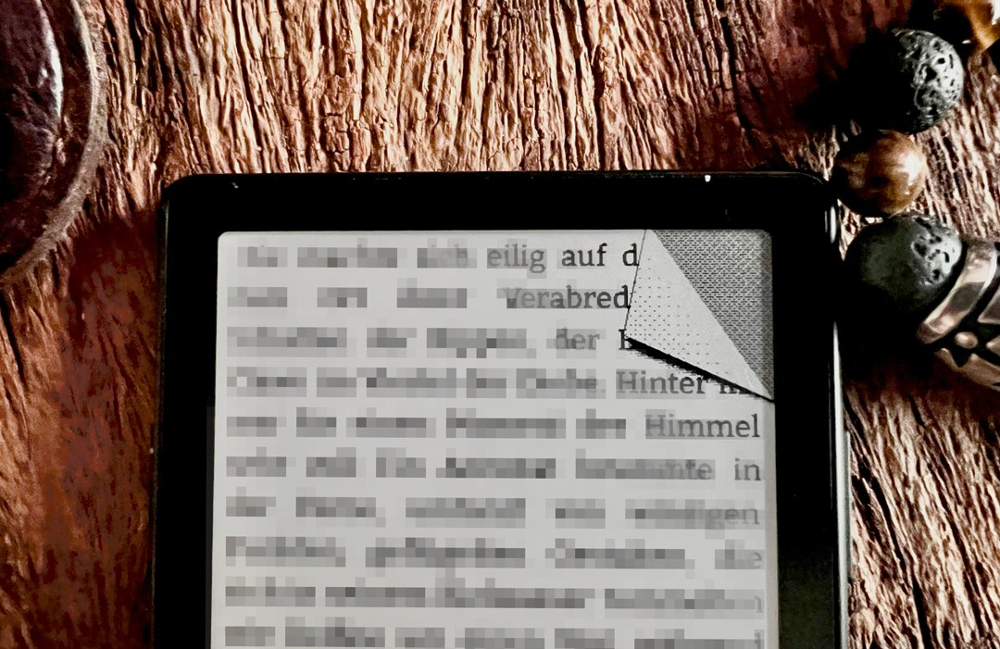

# CrossPoint Dog-ear

A small add-on for [CrossPoint Reader](https://github.com/crosspoint-reader/crosspoint-reader):
mark where you stopped reading with a realistic folded page corner ("dog-ear") instead of the
tiny bookmark icon.

> **Tested on the Xteink X4 Pro with CrossPoint 2.0.0.**
> The X3/X4 build is new and not tested on a device yet. Feedback welcome.

This repository does not contain a copy of CrossPoint. A GitHub Action takes every new official
CrossPoint release, adds the dog-ear and publishes the finished firmware under **Releases**.

| Device | File |
| --- | --- |
| Xteink X4 Pro | `crosspoint-<version>-x4pro.bin` |
| Xteink X3 and X4 (one file for both) | `crosspoint-<version>-x3-x4.bin` |

## How it works

One dog-ear per book. It is stored like a CrossPoint bookmark, so it survives font, margin and
orientation changes. In the settings the function is called **Dog-ear**.

### X4 Pro (touch screen and Home key)

The finger places the dog-ear, the Home key takes you back to it.

| Action | Result |
| --- | --- |
| **Long press the top-right corner** | Folds the corner on this page. An older dog-ear moves here. |
| **Tap the dog-ear** | Removes it |
| **Long press Home**, no dog-ear yet | Folds the corner on this page |
| **Long press Home**, dog-ear on another page | Jumps to the dog-ear |
| **Long press Home** on the dog-ear page | Nothing changes (short vibration) |

A long press never removes a dog-ear by accident. Removing is always a deliberate tap.

### X3 and X4 (buttons only)

Put **Dog-ear** on one key you don't use yet: **Confirm long press** or **Power short press**.

| Press the key… | Result |
| --- | --- |
| on a page without a dog-ear | Folds the corner here. An older dog-ear moves here. |
| on the dog-ear page | Removes it |

CrossPoint remembers your reading position anyway, so there is no separate "jump" key on these devices.

On all devices, **Reader menu → Toggle Dog-ear** works too.

## Install

1. Open the latest release and download the file for your device (see the table above).
2. Install it, either way works:
   - **SD card:** copy the file to the root of the SD card, then on the reader go to
     **Settings → SD Card Firmware Update** and pick the file.
   - **USB:** go to <https://crosspointreader.com/#flash-tools> in Chrome or Edge, choose your device,
     then **Custom .bin**, and upload the file.

After that, **Settings → Check for Updates** on the reader installs new versions from this
repository, so updates keep the dog-ear.

## Set up once (required)

The dog-ear needs a key. None is assigned by default.

**X4 Pro**
1. **Settings → Controls → Home Button Gestures → Long Press → Dog-ear**
2. **Settings → Controls → Touch Reader Controls → On** (for long press and tap on the corner)

**X3 / X4**, pick one:
- **Settings → Controls → Long-Press Menu → Dog-ear** (Confirm long press), or
- **Settings → Controls → Short Power Button Click → Dog-ear** (Power short press)

**All devices, optional:** **Settings → Reader → Text Anti-Aliasing**: off gives the fastest page
turns. The dog-ear looks the same either way.

## Look

The dog-ear has a fixed size and look on purpose: about a fifth of the screen width, a flat dark
corner, a white flap with a fine outline and a solid black shadow. Everything is drawn in pure
black and white dots, so nothing from the previous page shows through on e-ink.

It uses no extra memory: the corner is recalculated with simple integer math on each page draw,
which takes only a few milliseconds even on the X3/X4's small chip.

## Updates and maintenance

- The Action runs every night. When CrossPoint publishes a new release, a matching release appears here.
- To build by hand: **Actions → Build CrossPoint with dog-ear → Run workflow**
  (tick **force** to rebuild a version that already exists).
- If CrossPoint changes the code the patch hooks into, the build stops with a message that
  names the spot (`DOG-EAR PATCH FAILED: ...`). GitHub sends an email; then `patch/apply_dogear.py`
  needs an update. If only one device fails, the other one is still published.

## Files

- `patch/files/DogEarPaint.h`: drawing of the folded corner (no hardware code, can be previewed on a PC)
- `patch/files/DogEar.h`: connects the drawing to the CrossPoint renderer and the jump
- `patch/apply_dogear.py`: adds the dog-ear to a CrossPoint source tree
- `.github/workflows/build.yml`: nightly build and release for both devices

Self-built firmware does not include the official release key for CrossPoint's LCP service
(only relevant for LCP-protected books from that service). Everything else works as in the
official release.

MIT licensed, like CrossPoint.
